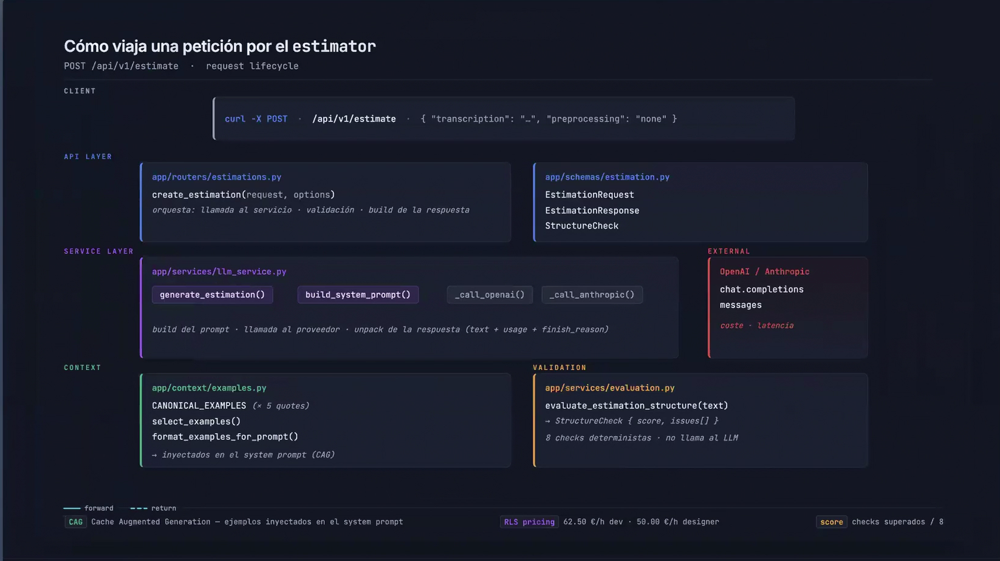
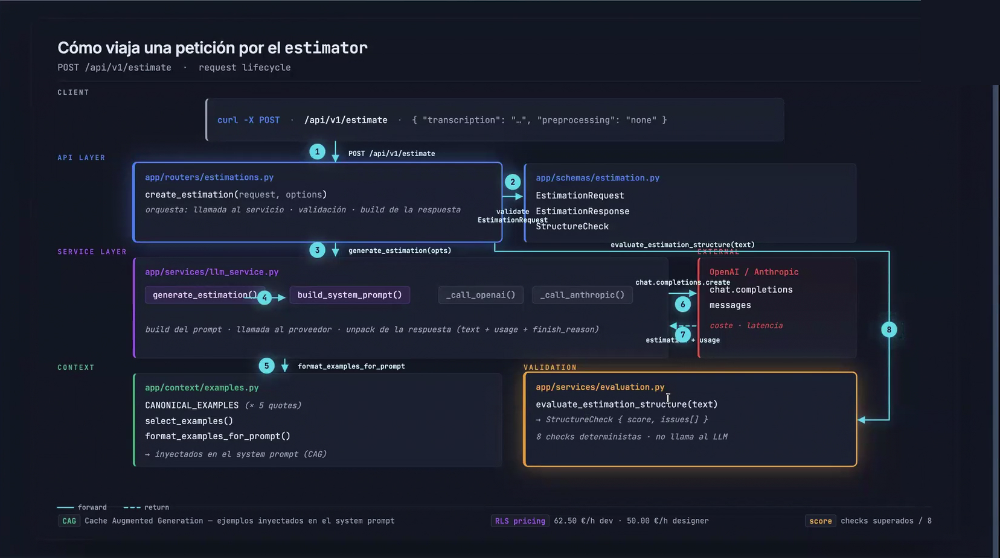

# Flujo de `POST /api/v1/estimate` en la solución de LIDR (sesión 2 en vivo)

> **Fuente:** repo [`LIDR-academy-temp/ai-engineering`](https://github.com/LIDR-academy-temp/ai-engineering), rama `session_2_live`, commit `7561f8c` ("end of session 2 update").
> **Archivos analizados** (en `estimator/app/`):
> - `schemas/estimation.py`
> - `routers/estimations.py`
> - `services/llm_service.py`
> - `services/evaluation.py`
> - `context/examples.py`
> - `config.py`
> - `fixtures/`

La rama `session_2_live` es el resultado de la sesión en vivo. Respecto a `session_2`, el ejercicio previo, añade unas 1.450 líneas. Casi todas son **controles para experimentar** y una **evaluación automática** de la respuesta.

---

## 1. Input: `EstimationRequest` (`schemas/estimation.py`)

Solo `transcription` es obligatorio. El resto son **controles por petición**, pensados para comparar configuraciones en directo sin tocar el código:

| Campo | Por defecto | Para qué sirve |
|---|---|---|
| `transcription` | — (mín. 50 caracteres) | Texto de la reunión |
| `preprocessing` | `none` | `none`, `inline_cleaning` o `two_phase`: cómo tratar una transcripción con ruido |
| `example_format` | `markdown` | Formato de los ejemplos CAG en el prompt: `markdown`, `json` o `narrative` |
| `num_examples` | `3` (0–5) | Cuántos de los 5 ejemplos canónicos se inyectan |
| `use_examples` | `true` | Desactiva los ejemplos por completo (con CAG frente a sin CAG) |
| `model` | `null` | Cambia `LLM_MODEL` solo para esta petición |
| `max_tokens` | `4000` (≤16000) | Límite de tokens de salida |
| `thinking_budget` | `null` | Presupuesto de razonamiento (solo Anthropic) |
| `evaluate` | `true` | Ejecuta la validación estructural de la respuesta |

Ejemplo de petición:

```bash
curl -s localhost:8000/api/v1/estimate -H 'Content-Type: application/json' -d '{
  "transcription": "A B2B SaaS company needs an admin portal ...",
  "preprocessing": "two_phase",
  "num_examples": 3,
  "example_format": "markdown"
}'
```

---

## 2. Proceso interno

```
HTTP JSON
  │  FastAPI + Pydantic validan el body (si falla → 422 automático)
  ▼
routers/estimations.py ── empaqueta los controles en GenerationOptions
  ▼
services/llm_service.py::generate_estimation
  ├─ ① [opcional] two_phase → extract_requirements()   ← 1ª llamada al LLM
  │       transcripción → lista limpia de requisitos (máx. 1.500 tokens)
  │       y esa lista sustituye a la transcripción como input del usuario
  ├─ ② build_system_prompt()   ← aquí está el CAG
  │       [rol] + [bloque de limpieza si inline_cleaning] + [tarifas]
  │       + [ACTIVE_OUTPUT_PROMPT] + [N ejemplos en el formato elegido]
  ├─ ③ modelo = request.model o LLM_MODEL; proveedor = LLM_PROVIDER (.env)
  ├─ ④ _call_openai (Chat Completions: mensajes system + user)
  │    o _call_anthropic (system aparte; si hay thinking_budget, activa el
  │       razonamiento y sube max_tokens)
  │       → los dos devuelven el mismo dict:
  │         estimation, model, provider, finish_reason, usage
  └─ ⑤ añade los tokens del preprocesado, preprocessing,
         extracted_requirements y latency_ms
  ▼
router: si evaluate → services/evaluation.py::evaluate_estimation_structure
        (solo regex, sin LLM)
  ▼
EstimationResponse (JSON)
```

En la grabación y el material de la sesión 3, este flujo se presenta con una diapositiva interactiva que recorre la petición en 9 pasos. La primera captura muestra las capas: cliente, API, servicio, contexto, validación y proveedor externo.



La segunda muestra el recorrido completo, en el paso 8 de 9:

1. El cliente hace `POST /api/v1/estimate`.
2. El router valida el `EstimationRequest`.
3. El router llama a `generate_estimation(opts)`.
4. `generate_estimation` llama a `build_system_prompt()`.
5. `build_system_prompt` usa `format_examples_for_prompt()` para inyectar los ejemplos (el CAG).
6. El servicio llama al proveedor con `chat.completions.create`.
7. Vuelven la estimación y el `usage`.
8. El router pasa el texto a `evaluate_estimation_structure()`: 8 comprobaciones deterministas, sin volver a llamar al LLM.



*Capturas de la grabación y el material de la sesión 3 de LIDR, recortadas para dejar solo la diapositiva.*

### 2.1 Cómo se compone el system prompt

`build_system_prompt` une secciones y descarta las vacías:

| Sección | Contenido |
|---|---|
| Rol | Consultor senior con más de 15 años de experiencia en estimación |
| Limpieza (solo con `inline_cleaning`) | Ignorar la charla irrelevante, sacar a la luz los requisitos implícitos y, ante contradicciones, quedarse con lo último que se dijo |
| Tarifas | 62,50 €/h desarrollo (500 €/día) y 50 €/h diseño (400 €/día) |
| `ACTIVE_OUTPUT_PROMPT` | `PROMPT_OUTPUT_BASIC` ("Generate an estimation…") o `PROMPT_OUTPUT_STRUCTURED` (secciones fijas y tabla `Task \| Hours \| Cost`) |
| Ejemplos | `select_examples(n)` coge los primeros *n* de `CANONICAL_EXAMPLES`; `format_examples_for_prompt` los convierte a Markdown, JSON o prosa |

- `ACTIVE_OUTPUT_PROMPT` es una constante que el tutor cambia **en directo**: `uvicorn --reload` recarga el código al momento.
- Los 3 formatos de ejemplo salen de la **misma fuente de datos** (`CanonicalExample`). El Markdown está precalculado para que no cambie entre ejecuciones.

### 2.2 Evaluación de nivel 1 (`services/evaluation.py`)

Usa solo regex y no llama al LLM. Hace 8 comprobaciones:

1. Título H2 (`## ...`).
2. Tabla con la cabecera `Task | Hours | Cost`.
3. Sección de totales (`Total hours` y `Total cost`).
4. Equipo recomendado.
5. Duración en semanas.
6. La suma de horas de la tabla coincide con el total declarado (±1 h).
7. La suma de costes coincide con el total declarado (±2 %).
8. `finish_reason` es `stop` o `end_turn`, es decir, la respuesta no se cortó.

`score` es la proporción de comprobaciones que se cumplen, e `issues` lista en lenguaje natural las que fallan.

---

## 3. Output: `EstimationResponse`

> JSON **ilustrativo**: muestra la forma de la respuesta, no los resultados de una ejecución real.

```json
{
  "estimation": "## Admin Portal ...\n| Task | Hours | Cost (EUR) |...",
  "model": "claude-haiku-4-5-20251001",
  "provider": "anthropic",
  "usage": {
    "input_tokens": 3900, "output_tokens": 850, "total_tokens": 4750,
    "preprocessing_input_tokens": 0, "preprocessing_output_tokens": 0
  },
  "finish_reason": "end_turn",
  "preprocessing": "none",
  "extracted_requirements": null,
  "latency_ms": 9200,
  "validation": {
    "has_breakdown_table": true,
    "declared_total_hours": 240, "sum_row_hours": 236, "hours_match": false,
    "score": 0.875,
    "issues": ["Total hours mismatch: declared 240 vs sum of rows 236"]
  }
}
```

Si el LLM falla, la respuesta es un **500** con el detalle del error.

---

## 4. Conceptos clave de la sesión 2

1. **CAG es pagar contexto en cada llamada.** Los ejemplos viajan siempre en el prompt. Con `num_examples` de 0 a 5 se ve el efecto en `usage.input_tokens`, en `latency_ms` y en `validation.score`. El experimento busca el punto de **rendimiento decreciente**: a partir de cierto número de ejemplos, cada uno más cuesta tokens pero apenas mejora la calidad.
2. **El formato de los ejemplos importa.** Con los mismos datos en Markdown, JSON o prosa, el modelo imita cosas distintas. Si los ejemplos están en Markdown con tabla, la respuesta tiende a traer tabla.
3. **Preprocesar el input:**
   - **`inline_cleaning`:** una sola llamada, con instrucciones de limpieza. Es barato, pero el modelo tiene que limpiar y estimar a la vez.
   - **`two_phase`:** dos llamadas. Cuesta más tokens y más latencia, pero el resultado intermedio (`extracted_requirements`) **se puede ver y depurar**. Es el patrón de *prompt chaining*.
   - El fixture `long_transcription.txt` tiene unas 5.500 palabras de reunión real, con saludos, divagaciones y dos partes, para que se note la diferencia. `short_transcription.txt` ya viene limpio.
4. **El prompt de salida y el evaluador forman un contrato.** Las regex buscan literalmente `Task | Hours | Cost` y `Total hours`, en inglés. Con el prompt BASIC, el formato depende de que el modelo copie los ejemplos y el `score` baja. Con el STRUCTURED, sube. Idea de fondo: **para evaluar automáticamente, primero hay que fijar el formato de salida**.
5. **Detectar truncados.** `finish_reason` (`length` / `max_tokens`) entra en el `score`. Una estimación cortada no debería darse por buena.
6. **Métricas en la respuesta.** `usage`, `latency_ms` y `validation.score` son lo que se proyecta en la sesión para comparar configuraciones. Es una primera forma de observabilidad.

Experimentos de la sesión (del `CLAUDE.md` de los tutores):

```bash
TRANS=$(jq -Rs . < estimator/app/fixtures/long_transcription.txt)

# Tres modos de preprocesado
for MODE in none inline_cleaning two_phase; do
  curl -s localhost:8000/api/v1/estimate -H 'Content-Type: application/json' \
    -d "{\"transcription\": $TRANS, \"preprocessing\":\"$MODE\"}" \
    | jq "{mode:\"$MODE\", score:.validation.score, latency_ms, usage}"
done

# Número de ejemplos CAG (rendimiento decreciente)
for N in 0 1 3 5; do
  curl -s localhost:8000/api/v1/estimate -H 'Content-Type: application/json' \
    -d "{\"transcription\": $TRANS, \"num_examples\": $N}" \
    | jq "{n: $N, input_tokens: .usage.input_tokens, latency_ms, score: .validation.score}"
done
```

---

## 5. Puntos débiles de su implementación

| Problema | Consecuencia |
|---|---|
| Clientes **síncronos** (`OpenAI()`, `Anthropic()`) dentro de un endpoint `async` | Bloquean el event loop: mientras el LLM responde (unos 7–10 s), el servidor no atiende otras peticiones |
| Se crea un cliente nuevo en cada llamada | Pierde la reutilización de conexiones |
| `except Exception` lo convierte todo en `LLMServiceError` → **500** | Un bug propio y un fallo del proveedor se ven igual. Para fallos del proveedor lo correcto es 502 |
| `thinking: {"type": "enabled", "budget_tokens": N}` | API antigua: funciona con Haiku 4.5, pero los modelos Claude recientes la rechazan con un 400 (usan `{"type": "adaptive"}` + `effort`) |
| `model` se puede cambiar por petición, pero el proveedor sale del `.env` | `model: "gpt-4o-mini"` con `LLM_PROVIDER=anthropic` falla |
| `two_phase` usa el mismo modelo en las dos fases | Lo habitual sería un modelo más barato para la extracción |
| `_to_int` del evaluador quita todo lo que no son dígitos | "12,500.00" se lee como 1.250.000 y "1.875,00 €" como 187.500: solo funciona con cantidades enteras |
| Anthropic: solo se queda con el **primer** bloque de texto (`next(...)`) | Si la respuesta viene en varios bloques de texto, se pierde el resto |

---

## 6. Comparación con nuestro `estimator/` (rama `session_2`)

El flujo de base es el mismo: validación → prompt CAG → LLM → JSON.

**Lo que ya tenemos y ellos no:**
- clientes async, cacheados por key;
- 502 para los fallos del proveedor;
- `finish_reason` normalizado (`stop` / `length`);
- coste estimado en USD;
- unión de **todos** los bloques de texto de Anthropic;
- ejemplos estructurados cuyos totales siempre cuadran (y un test lo verifica);
- modelo por defecto según el proveedor;
- CI con tests, smoke test y build de Docker.

**Lo que añadieron en la sesión en vivo y a nosotros nos falta:**
- [ ] Controles por petición: `num_examples`, `example_format`, `use_examples`, `preprocessing`, `model`, `max_tokens`
- [ ] Preprocesado `inline_cleaning` y `two_phase` (con `extracted_requirements` en la respuesta)
- [ ] Más ejemplos canónicos (5) y renderizado en 3 formatos (Markdown, JSON y prosa)
- [ ] Prompt de salida estructurado y conmutable
- [ ] Evaluador estructural de nivel 1 con `score` e `issues`
- [ ] Fixtures de transcripción corta y larga (con ruido)

Estos cambios encajan en una rama `session_2_live`, siguiendo la convención de la sesión 1.
