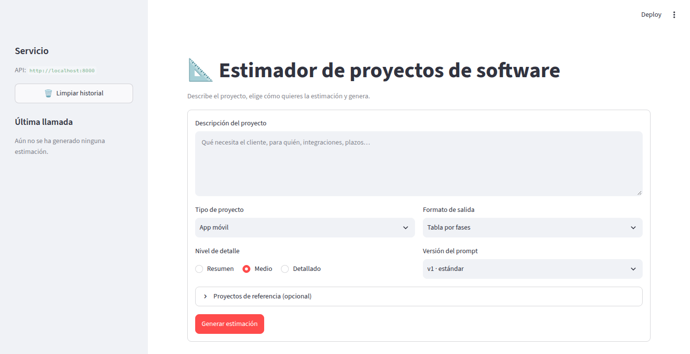

# Sesión 4: del chat a la interfaz de producto

> **Rama:** `pre-session-04`, creada a partir de `session_3`.
> **Objetivo del ejercicio:** sustituir el chat por un formulario que produce parámetros tipados, y sacar el prompt del código a templates Jinja2 versionados.
> **Hecho:** las cuatro partes y los tres bonus (prompt `v2` con `?prompt_version`, `reference_projects` y log del prompt renderizado).



## Qué ha cambiado

| Antes (sesión 3) | Ahora |
|---|---|
| Chat: el usuario escribía lo que quisiera | `st.form`: descripción + tipo de proyecto + nivel de detalle + formato + versión del prompt + proyectos de referencia |
| Body `{"transcription": "..."}` | `EstimationRequest` con tres enums y una lista opcional de `ReferenceProject` |
| `build_system_prompt()`: un f-string en `llm_service.py` | `app/prompts/estimation/v1/{system,user,examples}.j2` + `loader.py` |
| Ejemplos CAG en `app/context/examples.py` | `examples.j2`: los datos y su presentación, versionados con el prompt |
| La respuesta era el texto con las métricas mezcladas | `{text, prompt_version, metadata}` |

El wrapper de proveedores, la caché, el streaming SSE y structlog de la sesión 3 no han cambiado. El servicio solo pasa a obtener `(system, user)` del loader.

```
Formulario ─▶ EstimationRequest ─▶ render_estimation_prompt(request, "v1")
                                       ├─ system.j2  (+ include examples.j2)
                                       └─ user.j2
                                   ─▶ LLMWrapper.stream(system, [{"role": "user", "content": user}])
```

---

## Objetivos de aprendizaje

### 1. Por qué un formulario tipado es mejor producto que un textarea libre (cuando las tareas posibles son pocas)

- **El usuario no tiene que saber hacer prompts.** En el chat, cada persona pedía el formato y el nivel de detalle a su manera, o se le olvidaba. Ahora elige entre opciones cerradas y el prompt bien escrito lo pone el servicio.
- **Resultados reproducibles y comparables.** Los mismos parámetros dan el mismo prompt (el hash de `prompt_rendered` lo demuestra) y, por tanto, la misma entrada de caché. Dos estimaciones con `phases_table` / `detailed` se pueden comparar fila a fila.
- **La validación ocurre antes de gastar tokens.** Una descripción de 5 caracteres o un `output_format` que no existe dan 422 sin llamar al LLM. En el chat, eso costaba una llamada y una respuesta inútil.
- **Cada opción es un caso que se puede probar.** Hay 4 × 3 × 3 = 36 combinaciones y un test las renderiza todas. Un textarea libre tiene infinitas entradas y ninguna se puede probar de antemano.
- **Menos superficie de prompt injection.** El texto libre del usuario queda confinado a `<project_description>`, y el system indica que lo que hay dentro son datos, no instrucciones.

**Cuándo no conviene:** cuando las tareas posibles son abiertas (un asistente general, preguntas libres sobre un documento). Ahí el chat sigue siendo la interfaz natural. Aquí el producto hace una sola cosa, estimar, con pocas variantes.

### 2. Por qué un prompt en `.j2` con un loader es más mantenible que un f-string en el endpoint

- **Separación de responsabilidades:** el endpoint decide *qué* se pide; el template, *cómo se le dice* al modelo. Cambiar la redacción no toca Python, y la revisión de un PR que solo cambia un `.j2` es una revisión de texto.
- **Lógica legible donde hace falta:** ``, `` y `` expresan las variantes del prompt mejor que concatenar strings con `if` en Python.
- **`StrictUndefined`:** si el template usa `{{ descripcion }}` y el contexto trae `description`, el render falla en el test. Con un f-string, un error así revienta en ejecución o, peor, con `.format(**kwargs)` y valores por defecto, se envía un prompt con huecos sin que nadie se entere.
- **`trim_blocks` / `lstrip_blocks`:** las etiquetas de control no dejan líneas en blanco ni sangrías. El prompt que recibe el modelo es limpio (un test comprueba que no hay tres saltos de línea seguidos).
- **Un único punto de entrada:** `render_estimation_prompt(request, version)` es la única forma de construir el prompt. Ahí se centralizan el log, el hash y la validación de la versión.

### 3. Cómo se versiona un prompt y por qué `v1/`, `v2/` no es opcional

- **Un prompt es código de producción:** cambia el comportamiento del sistema igual que cambiar una función. Si se edita en el sitio, se pierde la referencia: no se puede comparar el antes y el después, ni volver atrás sin un deploy.
- **Con carpetas por versión:**
  - **Coexisten:** `?prompt_version=v1` y `?prompt_version=v2` funcionan a la vez. Se pueden comparar con las mismas entradas (A/B) o activar una versión para unos clientes y no para otros.
  - **Trazabilidad:** cada respuesta lleva `prompt_version`, y cada log lleva la versión y el hash del contenido. Ante una estimación rara en producción se sabe exactamente qué prompt la generó.
  - **Caché correcta:** la clave de la caché incluye el prompt renderizado, así que v1 y v2 nunca se mezclan.
  - **Rollback:** volver a v1 es cambiar un parámetro, no revertir un commit.
- **Versiones autocontenidas:** `v2/` no incluye nada de `v1/`. Si v2 dependiera de v1, editar v1 cambiaría v2 sin que nadie lo decidiera. La duplicación es el precio de la inmutabilidad, y merece la pena.
- **Regla práctica:** una versión publicada no se edita. Un cambio de comportamiento crea `v3/`. Corregir una errata que no cambia el comportamiento es discutible; ante la duda, versión nueva.
- **Variación deliberada en v2:** estimador conservador con rangos optimista / probable / pesimista por fase, línea de contingencia del 15 %, resumen ejecutivo al principio y ejemplos recalculados con rangos.

### 4. Qué cubre un test de template y qué no

| Cubre (`tests/prompts/`, milisegundos, sin red) | No cubre |
|---|---|
| Que cada parámetro activa su bloque: `phases_table` → `confidence_pct`; `detailed` → "asunciones de cada fase"; y que los bloques que no tocan no aparecen | Que el modelo **obedezca** esas instrucciones (que devuelva de verdad la columna `confidence_pct`) |
| Que la descripción va literal dentro de `<project_description>` y fuera del system | Que la estimación sea **buena** o razonable |
| Que las 36 combinaciones renderizan sin variables sin definir ni etiquetas sin procesar | Que la **aritmética** del modelo cuadre (en una prueba real con v2, el modelo sumó mal la contingencia) |
| Que los ejemplos salen en el formato pedido y sus totales cuadran | Regresiones de calidad al cambiar de modelo o de versión de prompt |
| Que una versión inexistente o una variable que falta fallan | Latencia, coste o límites del proveedor |

Lo que no cubren los tests de template corresponde a **evaluaciones** (evals) sobre las respuestas reales del modelo y a **guardrails** sobre la salida. El enunciado deja ambas cosas para el directo, junto con la salida en JSON estructurado.

---

## Decisiones de diseño

- **`EstimationResponse` = contrato del enunciado + `metadata`.** `text` y `prompt_version` están tal cual. Las métricas (modelo, tokens, latencia, coste, `cached`) van en un campo aparte, para no perder lo que alimenta el panel lateral y los logs. En SSE, el evento `done` lleva `{prompt_version, metadata}`.
- **Enums con `StrEnum`** en lugar de `class X(str, Enum)`: es su equivalente en Python 3.11+ (lo recomienda ruff), se serializa igual y `str()` devuelve el valor.
- **El formulario usa `/estimate/stream`** para no perder el streaming. Envía el mismo JSON que `/estimate`, que también está refactorizado y probado.
- **Ejemplos como datos en `examples.j2`.** Los proyectos son inventados y de tipos distintos (app móvil, herramienta interna, pipeline de datos). Una macro los pinta en el `output_format` y el `detail_level` pedidos. Así un ejemplo en tabla no contradice una petición en prosa, y los totales se calculan en el template.
- **Tarifas fuera del template:** `HOURLY_RATES` vive en `loader.py` y llega a los templates como `rates`. Son datos de negocio, no redacción. El filtro `eur` formatea los importes al estilo español.
- **`reference_projects` en el `user`, no en el `system`:** son datos de esta petición, como la descripción. Llevan `actual_hours`, que es lo que hace útil la referencia: cuánto costó de verdad.
- **Cliente separado de la interfaz:** `estimator_client.py` (opciones, HTTP/SSE, helpers) no depende de Streamlit; `streamlit_app.py` solo pinta. Así los helpers se prueban importándolos con normalidad, y un test vigila que las opciones del formulario coincidan con los enums de la API, porque la UI no importa `app/`.

## Verificación con llamadas reales (OpenAI `gpt-4o-mini`)

| Prueba | Resultado |
|---|---|
| `/estimate?prompt_version=v1`, `web_saas` / `detailed` / `phases_table` | Tabla por fases con `confidence_pct`, asunciones por fase, riesgos y preguntas abiertas. Totales correctos (240 h, 14.500 €) |
| La misma petición con `v2` | Resumen ejecutivo, horas en rangos, contingencia del 15 % y coste con contingencia. El modelo sumó mal el total con contingencia: un caso para los guardrails del directo |
| Formulario en Chrome (`mobile_app` / `detailed` / `phases_table`) | Estimación en streaming, en tabla por fases |
| Logs de uvicorn | `prompt_rendered` con hash, y `prompt_version` y los tres parámetros en `llm_call_completed` |

## Tests

145 tests en unos 3 s; los de `tests/prompts/` (50) tardan 0,2 s. Detalle en el [README del estimador](../estimator/README.md#tests).
