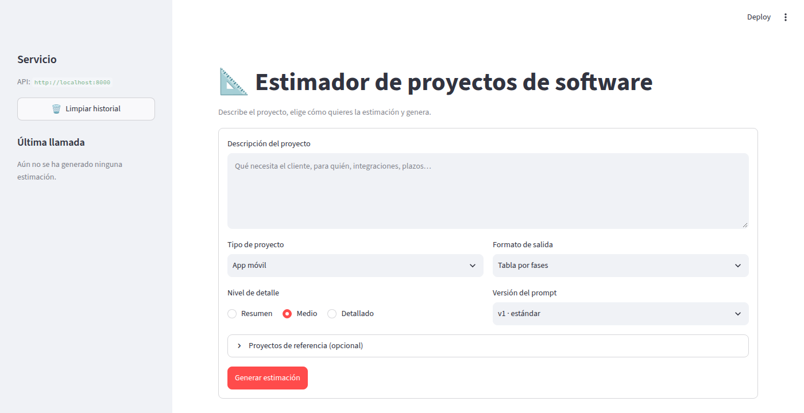

# Estimador CAG

Servicio FastAPI que genera **estimaciones de proyectos de software** con un LLM (OpenAI o Anthropic). Recibe la descripción del proyecto y unos parámetros tipados: tipo de proyecto, nivel de detalle y formato de salida. Incluye un cliente web hecho con Streamlit: un formulario.

Proyecto 1 del curso AI Engineering de LIDR. Se empezó en la sesión 2 y se irá mejorando en las siguientes.



```
Streamlit (formulario) ──HTTP/SSE──▶ FastAPI ──▶ llm_service ──▶ LLMWrapper ──▶ OpenAI / Anthropic
 sin API keys                         /api/v1     │               caché exact-match
                                                  │               logs (structlog)
                                                  ▼
                                        prompts/loader.py → estimation/v1|v2/*.j2
```

## Arquitectura

### Prompts versionados (Jinja2)

El prompt no está en el código: vive en templates Jinja2, una carpeta por versión.

```
app/prompts/
├── loader.py                  render_estimation_prompt(request, version) -> (system, user)
└── estimation/
    ├── v1/                    estándar
    │   ├── system.j2          rol, reglas, bloques según project_type, output_format y detail_level
    │   ├── user.j2            <project_type>, <project_description> y <reference_projects>
    │   └── examples.j2        3 estimaciones de referencia (CAG), pintadas en el formato pedido
    └── v2/                    conservador: rangos optimista/probable/pesimista y contingencia del 15 %
```

- **`system` y `user` viajan como mensajes separados.** El `system` lleva las instrucciones y los ejemplos; el `user`, los datos del cliente.
- **Configuración del entorno Jinja2:**
  - `StrictUndefined`: una variable que falta es un error, no un hueco;
  - `trim_blocks` y `lstrip_blocks`: las etiquetas no dejan líneas en blanco.
- **CAG** (Cache Augmented Generation): no hay base de datos ni retrieval. Las estimaciones de referencia viajan en el `system`.
  - En `examples.j2` los ejemplos están como datos (fases, tareas, horas) y se pintan en el `output_format` y el `detail_level` pedidos, para no contradecir las instrucciones.
  - Los totales y costes se calculan en el template con las tarifas, así que siempre cuadran.
- **Cada render se registra** con el evento `prompt_rendered`: versión y hash del contenido.

**Para crear una versión nueva:**
1. Copia `v1/` a `v3/` y cambia lo que quieras.
2. Añade `"v3"` a `PromptVersion` en `app/schemas.py`. Un test comprueba que cada versión declarada tiene su carpeta.

El endpoint y el wrapper no cambian. La caché tampoco necesita tocarse: su clave incluye el prompt renderizado, así que cada versión tiene sus propias entradas.

### Archivos

| Carpeta / archivo | Responsabilidad |
|---|---|
| `app/main.py` | Aplicación FastAPI, `GET /health`, router en `/api/v1`, middleware de `request_id` |
| `app/config.py` | Configuración con Pydantic Settings, leída de `.env` |
| `app/logging_config.py` | Logging estructurado con structlog: consola en desarrollo, JSON en producción |
| `app/schemas.py` | Contrato tipado: enums, `EstimationRequest`, `EstimationResponse` |
| `app/prompts/` | Loader y templates Jinja2 versionados |
| `app/routers/estimations.py` | `POST /api/v1/estimate` y `POST /api/v1/estimate/stream` (SSE) |
| `app/services/llm_service.py` | Renderiza el prompt y lo envía al wrapper |
| `app/services/llm_wrapper.py` | Wrapper de proveedores: OpenAI y Anthropic tras una sola interfaz, normal o en streaming; caché, coste y logs de cada llamada |
| `app/services/cache.py` | Caché exact-match en memoria (LRU + TTL) |
| `streamlit_app.py` | Interfaz web: el formulario |
| `estimator_client.py` | Cliente HTTP/SSE de la API, sin Streamlit: opciones del formulario, lectura del stream |
| `data/peticion_ejemplo.json` | Body de ejemplo para probar con curl |

## Puesta en marcha

```bash
cd estimator
cp .env.example .env     # y pon tu API key
uv sync
uv run uvicorn app.main:app --reload
```

- Swagger: <http://localhost:8000/docs>
- Health: <http://localhost:8000/health>

> La configuración se cachea al arrancar. Si cambias `.env` (por ejemplo, el `LLM_PROVIDER`), **reinicia uvicorn**: `--reload` solo detecta cambios en el código. Los templates `.j2` no necesitan reinicio: Jinja comprueba si el fichero ha cambiado antes de usarlo.

### Interfaz web (Streamlit)

Con la API arrancada, en otra terminal:

```bash
cd estimator
uv run streamlit run streamlit_app.py     # http://localhost:8501
```

- **Formulario:**
  - descripción del proyecto (20–2000 caracteres);
  - tipo de proyecto;
  - formato de salida;
  - nivel de detalle;
  - versión del prompt;
  - proyectos de referencia, opcionales: hasta 5, con sus horas reales.
- **Envío:** genera un `EstimationRequest` y la estimación aparece en streaming (`POST /estimate/stream`).
- **Historial:** las estimaciones anteriores quedan debajo, en desplegables, con sus parámetros.
- **Panel lateral:** versión del prompt, modelo, tokens, tiempo y coste de la última llamada, y si la respuesta vino de la caché.
- **Sin secretos:** la UI es un **cliente HTTP puro**. No importa `app/` ni conoce ninguna API key; solo usa `ESTIMATOR_API_URL`, por defecto `http://localhost:8000`.
- **Fuera de la imagen Docker:** Streamlit, httpx y pandas están en el grupo de dependencias `ui`. `uv sync` los instala, pero la imagen de la API no.
- **Sin telemetría:** [`.streamlit/config.toml`](.streamlit/config.toml) desactiva las estadísticas de uso que Streamlit envía por defecto desde el navegador.

> Si tienes otro proyecto con una API en el puerto 8000 (por ejemplo, el repo de LIDR), arranca esta en otro puerto y apunta la UI a él: `uvicorn app.main:app --port 8001` y `ESTIMATOR_API_URL=http://localhost:8001 uv run streamlit run streamlit_app.py`.

### Con Docker

```bash
cd estimator
cp .env.example .env     # y pon tu API key
docker compose up --build
```

- La imagen es multi-stage, con las dependencias instaladas por uv desde `uv.lock`. Corre con un usuario **no root** y trae un `HEALTHCHECK` sobre `/health`.
- `docker compose` lee las keys de `.env` al arrancar. El `.env` **nunca entra en la imagen**: lo excluye `.dockerignore`.
- En desarrollo, compose monta `./app` (incluidos los templates) y arranca con `--reload`. Para producción hay que quitar el volumen y el `--reload`.
- Si cambias `.env`, ejecuta `docker compose up -d` para recrear el contenedor.
- Para pararlo: `docker compose down`.

### Variables de entorno

| Variable | Descripción | Por defecto |
|---|---|---|
| `OPENAI_API_KEY` | API key de OpenAI | Obligatoria si `LLM_PROVIDER=openai` |
| `ANTHROPIC_API_KEY` | API key de Anthropic | Obligatoria si `LLM_PROVIDER=anthropic` |
| `LLM_PROVIDER` | `openai` o `anthropic` | `openai` |
| `LLM_MODEL` | Modelo que se usa | `gpt-4o-mini`, o `claude-haiku-4-5` si el proveedor es Anthropic |
| `APP_ENV` | `development`, `staging` o `production` | `development` |
| `LOG_LEVEL` | `DEBUG`, `INFO`, `WARNING` o `ERROR` | `DEBUG` |
| `CACHE_ENABLED` | Activa la caché exact-match de respuestas | `true` |
| `CACHE_TTL_SECONDS` | Caducidad de cada entrada de la caché | `86400` (24 h) |
| `CACHE_MAX_ENTRIES` | Máximo de entradas; al llenarse sale la menos usada (LRU) | `256` |
| `ESTIMATOR_API_URL` | Solo para la UI: URL de la API | `http://localhost:8000` |

## API

### `POST /api/v1/estimate`

| Campo del body | Tipo | Valores |
|---|---|---|
| `description` | string | 20–2000 caracteres |
| `project_type` | enum | `mobile_app`, `web_saas`, `internal_tool`, `data_pipeline` |
| `detail_level` | enum | `summary`, `medium`, `detailed` |
| `output_format` | enum | `phases_table`, `line_items`, `narrative` |
| `reference_projects` | lista, opcional | Hasta 5 `{name, description, actual_hours}` |

El query param `prompt_version` admite `v1` (por defecto) o `v2`. Los enums se envían con su valor exacto (`"mobile_app"`, no `"MOBILE_APP"`). Cualquier otro valor devuelve **422**.

```bash
curl -s -X POST "http://localhost:8000/api/v1/estimate?prompt_version=v1" \
  -H "Content-Type: application/json" -d @data/peticion_ejemplo.json | jq
```

```json
{
  "text": "## Estimación: Landing page con CRM y blog\n\n| Fase | Tareas | Perfil | Horas | Coste | confidence_pct |...",
  "prompt_version": "v1",
  "metadata": {
    "model": "gpt-4o-mini-2024-07-18",
    "provider": "openai",
    "usage": {"input_tokens": 1632, "output_tokens": 495, "total_tokens": 2127},
    "finish_reason": "stop",
    "latency_ms": 7788,
    "estimated_cost_usd": 0.000542,
    "cached": false,
    "created_at": "2026-11-05T00:06:16Z"
  }
}
```

- `text` y `prompt_version` son el contrato del enunciado; `metadata` añade las métricas de la llamada.
- `finish_reason: "length"` indica que la respuesta se cortó por el límite de tokens.
- Si el proveedor falla (key inválida, sin crédito…), el endpoint responde **502**.
- Si repites exactamente la misma petición con la misma versión, la respuesta sale de la caché: `cached: true` y coste 0.

### `POST /api/v1/estimate/stream` (Server-Sent Events)

Mismo body y mismo query param. Devuelve la estimación token a token (`-N` desactiva el buffer de curl):

```bash
curl -N -X POST "http://localhost:8000/api/v1/estimate/stream?prompt_version=v2" \
  -H "Content-Type: application/json" -d @data/peticion_ejemplo.json
```

| Evento | `data` (siempre JSON) |
|---|---|
| `token` | Trozo de texto de la estimación |
| `done` | `{"prompt_version": ..., "metadata": {...}}`: lo mismo que `/estimate`, sin `text` |
| `error` | `{"detail": "..."}` si el proveedor falla a mitad del stream. La respuesta ya empezó con 200, así que el error no puede ser un código HTTP |

### Logs

Cada petición lleva un `request_id`, que se devuelve en la cabecera `X-Request-ID`. Todos sus logs lo incluyen, junto con `prompt_version`, `project_type`, `detail_level` y `output_format`. Eventos principales:

- `prompt_rendered`: versión y `sha256` corto del system y del user. Si dos peticiones tienen el mismo hash, el modelo recibió exactamente el mismo prompt.
- `llm_call_completed`: proveedor, modelo, tokens, latencia, coste, `cached`.
- `llm_call_failed`.
- `cache_hit` / `cache_miss` (en `DEBUG`).
- `estimation_stream_started` / `estimation_stream_finished`.

## Tests

```bash
uv run ruff check . && uv run ruff format --check .
uv run pytest                    # todo (~3 s)
uv run pytest tests/prompts      # solo los templates (milisegundos)
```

Los tests no llaman al LLM, así que no cuestan dinero:

- **`tests/prompts/`**: tests de los templates. Comprueban el texto que recibe el modelo:
  - la descripción va dentro de `<project_description>`;
  - `phases_table` pide `confidence_pct` y `narrative` no;
  - `detailed` pide las asunciones por fase y `summary` no;
  - las 36 combinaciones de parámetros renderizan;
  - una variable que falta da error (`StrictUndefined`);
  - los ejemplos cuadran;
  - v2 añade rangos y contingencia.

  No pueden comprobar que el modelo cumpla las instrucciones.
- **`test_estimate.py`**: los endpoints con un wrapper falso. Comprueba el nuevo contrato, que `system` y `user` llegan separados, `?prompt_version`, los 422 (enum inválido, descripción corta o larga, versión inexistente) y los eventos SSE.
- **`test_llm_wrapper.py` y `test_cache.py`**: el parseo de los dos SDKs, normal y en streaming, el coste, la caché y los errores.
- **`test_streamlit_app.py`**: la UI de punta a punta con `AppTest`. El formulario llama a la API real por SSE, con el wrapper falso detrás, y se comprueba que la API recibe exactamente el prompt de esos parámetros. También cubre que las opciones de la UI coinciden con los enums de la API y los errores.

El workflow [`.github/workflows/estimator.yml`](../.github/workflows/estimator.yml) ejecuta todo esto en cada push que toque `estimator/`. Después arranca el servicio y construye la imagen Docker.

## Checklist del ejercicio (sesión 4)

- [x] Schemas Pydantic v2 con enums: `ProjectType`, `DetailLevel`, `OutputFormat`, `EstimationRequest`, `EstimationResponse` (`text`, `prompt_version`)
- [x] Formulario `st.form` en lugar del chat, que envía un `EstimationRequest`
- [x] `app/prompts/estimation/v1/` con `system.j2`, `user.j2` y `examples.j2` (con ``)
- [x] `loader.py` con `render_estimation_prompt(request, version="v1") -> (system, user)`, `StrictUndefined`, `trim_blocks` y `lstrip_blocks`
- [x] `POST /estimate` con body tipado, `system` y `user` como mensajes separados, y `prompt_version="v1"`
- [x] Wrapper de proveedores de la sesión 3 sin cambios
- [x] Tests del template en `tests/prompts/test_estimation_v1.py`
- [x] Bonus: `v2/` y `?prompt_version=v2`
- [x] Bonus: `reference_projects` recorrido con ``
- [x] Bonus: log del prompt renderizado con structlog (versión y hash)

Los checklists de las sesiones 2 y 3 están en el historial de git y en [`docs/`](../docs/README.md).
